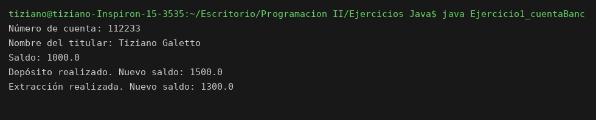

# CuentaBancaria

Programación II - Unidad 3 - Ejercicio 1

## Consigna
Modelar una cuenta bancaria aplicando encapsulamiento: atributos privados, constructor que valida y métodos que validan antes de modificar el saldo.

## Lógica
- Atributos privados `numeroCuenta`, `nombreTitular` y `saldo`.
- El constructor lanza `IllegalArgumentException` si el saldo inicial es negativo.
- `Depositar(monto)` rechaza montos menores o iguales a 0 y suma al saldo.
- `Extraer(monto)` rechaza montos inválidos y también si el monto supera el saldo.
- El saldo solo se puede leer con `getSaldo()`; no hay setter.

## Ejecución

